*******************************
Mockup/clientes:

*Nombre*: Pantalla splash
*ID*: 01
*Tamaño*: 428 x 891 
*Accion principal*: Mostrar logo y slogan al iniciar
*Ruta HTML*: "view\clients\index.html"
*Imagen*:
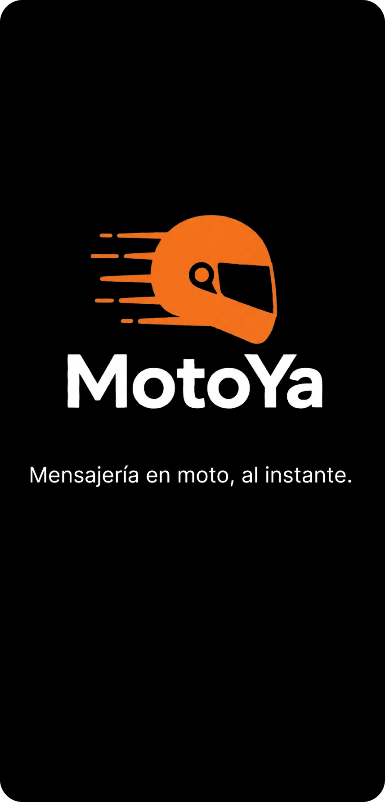
*Enlace*:
https://www.figma.com/design/Tk1cb6MQQsDdMOV6BCJTEo/Motoya-R3?node-id=372-88&t=yfqhY9mX0mEi1GvO-4

*Nombre*: Bienvenida y selección de rol
*ID*: 02
*Tamaño*: 390 x 891 
*Accion principal*: Dar bienvenida al usuario y la opcion de seleccionar el rol con el que quiere continuar
*Ruta HTML*: "view\clients\guia-informativa.html"
*Imagen*:
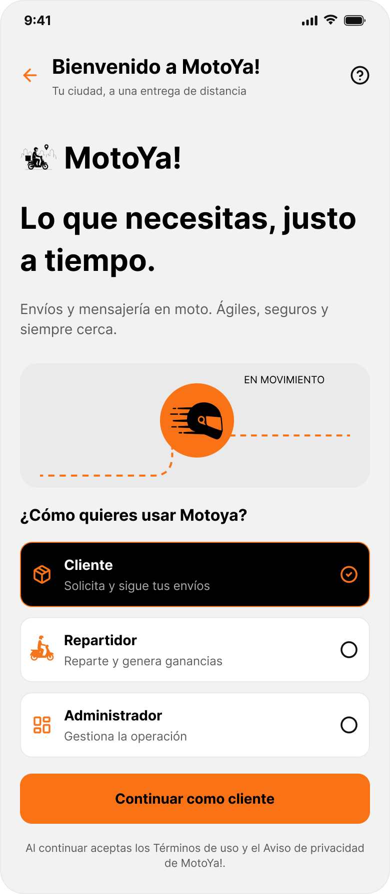
*Enlace*:https://www.figma.com/design/Tk1cb6MQQsDdMOV6BCJTEo/Motoya-R3?node-id=362-2404&t=yfqhY9mX0mEi1GvO-4

*Nombre*: Iniciar sesión
*ID*: 03
*Tamaño*: 390 x 876 
*Accion principal*: Iniciar sesion en la app
*Ruta HTML*: "view\clients\bienvenido.html"
*Imagen*:
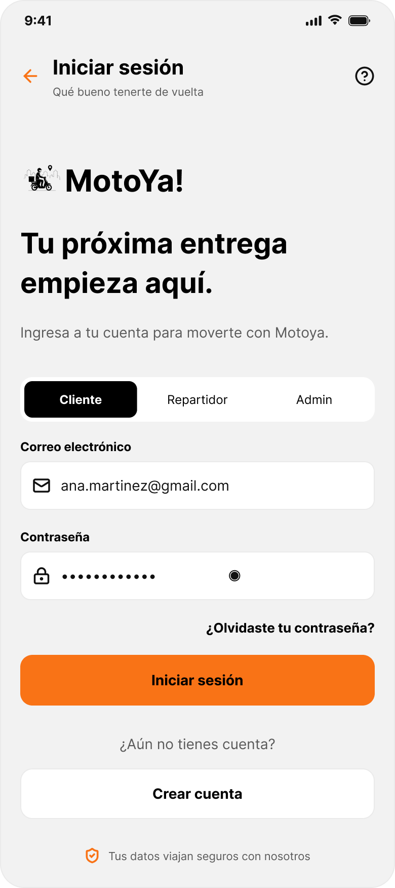
*Enlace*:
https://www.figma.com/design/Tk1cb6MQQsDdMOV6BCJTEo/Motoya-R3?node-id=362-2346&t=yfqhY9mX0mEi1GvO-4

*Nombre*: Registro
*ID*: 04
*Tamaño*: 428 x 851 
*Accion principal*: Registrarse como usuario en la app
*Ruta HTML*: "view\clients\crea-tu-cuenta.html"
*Imagen*:
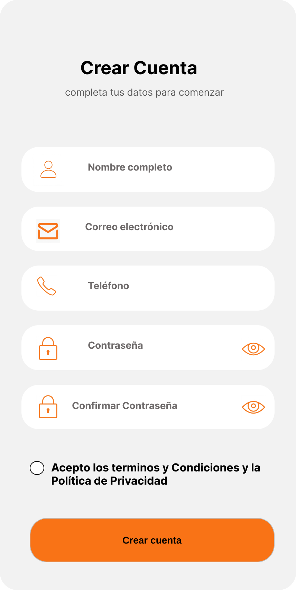
*Enlace*:
https://www.figma.com/design/Tk1cb6MQQsDdMOV6BCJTEo/Motoya-R3?node-id=375-93&t=yfqhY9mX0mEi1GvO-4

*Nombre*: solicitar envío
*ID*: 05
*Tamaño*: 390 x 851 
*Accion principal*: solicitar un envio
*Ruta HTML*: "view\clients\pedidos.html"
*Imagen*:
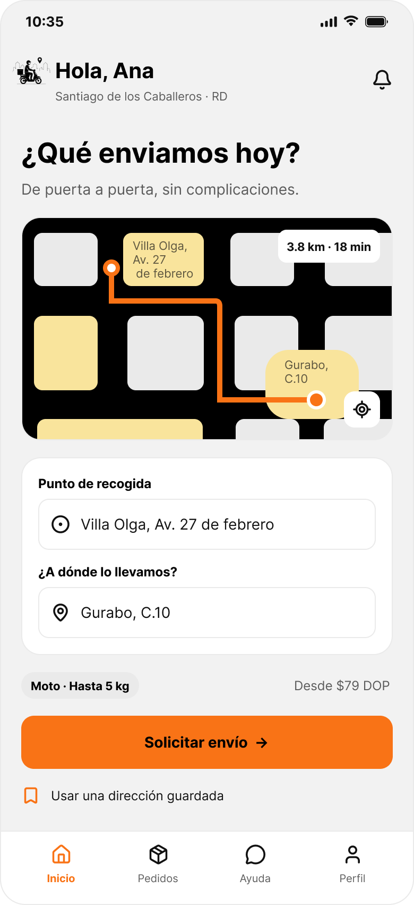
*Enlace*:
https://www.figma.com/design/Tk1cb6MQQsDdMOV6BCJTEo/Motoya-R3?node-id=362-2261&t=yfqhY9mX0mEi1GvO-4

*Nombre*: Detalles del envío
*ID*: 06
*Tamaño*: 390 x 844 
*Accion principal*: Muestra los detalles del envio
*Ruta HTML*: "view\clients\detalle.html"
*Imagen*:
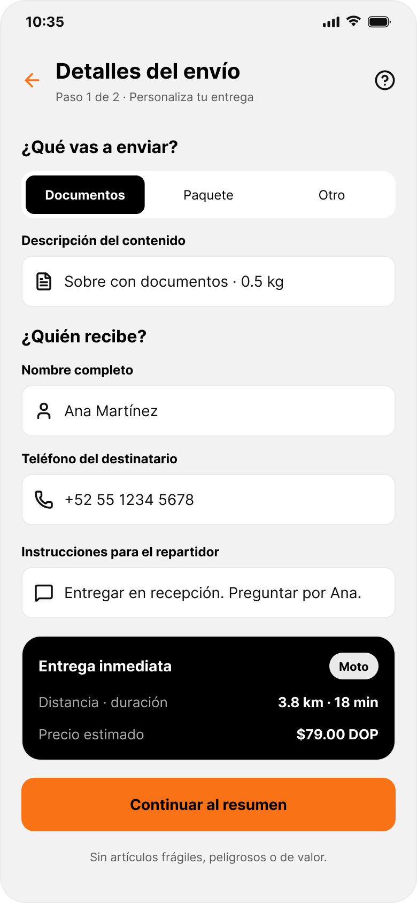
*Enlace*:
https://www.figma.com/design/Tk1cb6MQQsDdMOV6BCJTEo/Motoya-R3?node-id=362-2193&t=yfqhY9mX0mEi1GvO-4

*Nombre*: Confirmar pedido
*ID*: 07
*Tamaño*: 390 x 844 
*Accion principal*: Pagar y confirmar el pedido
*Ruta HTML*: "view\clients\confirmar-pedido.html"
*Imagen*:
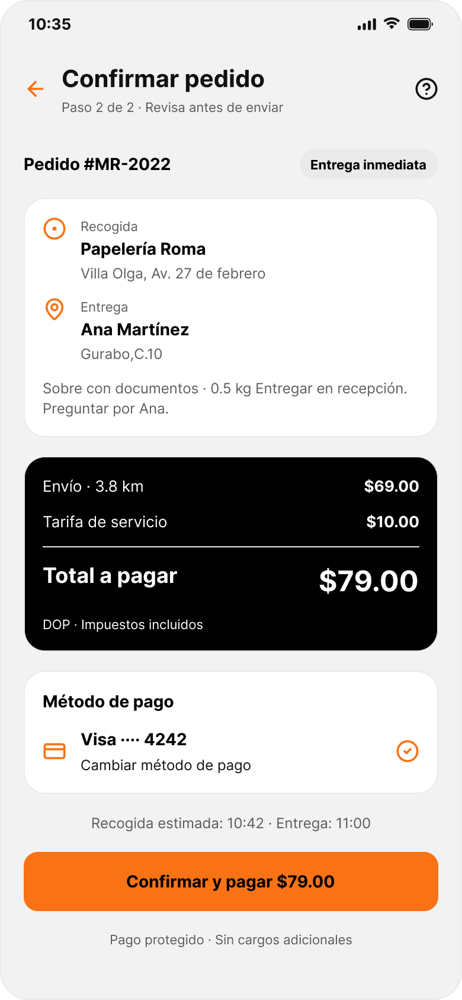
*Enlace*:
https://www.figma.com/design/Tk1cb6MQQsDdMOV6BCJTEo/Motoya-R3?node-id=362-2128&t=yfqhY9mX0mEi1GvO-4

*Nombre*: Seguimiento del envío
*ID*: 08
*Tamaño*: 390 x 844 
*Accion principal*: ver en tiempo real la ubicacion del pedido y poder contactar al repartidor 
*Ruta HTML*: "view\clients\ruta.html"
*Imagen*:
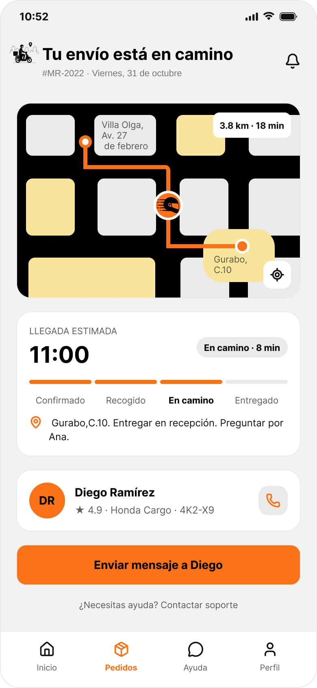
*Enlace*:
https://www.figma.com/design/Tk1cb6MQQsDdMOV6BCJTEo/Motoya-R3?node-id=362-2033&t=yfqhY9mX0mEi1GvO-4

*Nombre*: Historial de pedidos
*ID*: 09
*Tamaño*: 390 x 844 
*Accion principal*: Poder observar los pedidos que has realizado 
*Ruta HTML*: "view\clients\mis-pedidos.html"
*Imagen*:
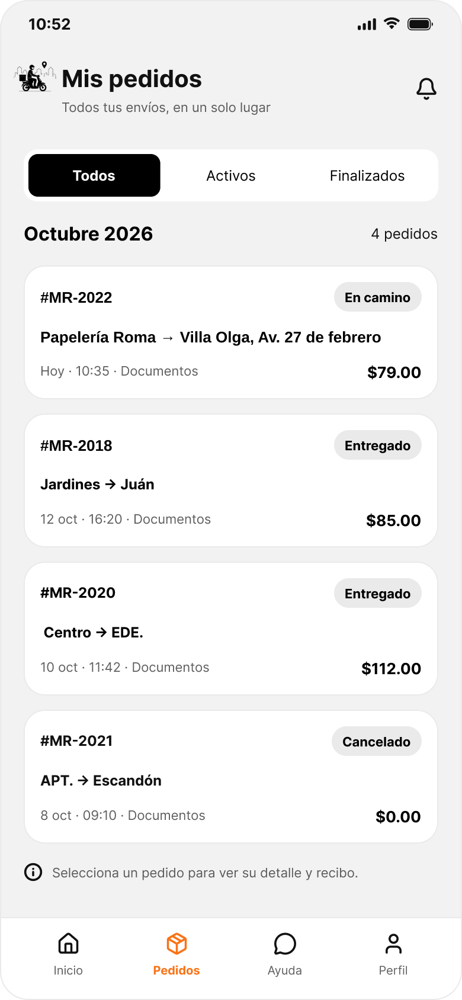
*Enlace*:
https://www.figma.com/design/Tk1cb6MQQsDdMOV6BCJTEo/Motoya-R3?node-id=362-1946&t=yfqhY9mX0mEi1GvO-4

*Nombre*: Ayuda
*ID*: 10
*Tamaño*: 390 x 844 
*Accion principal*: Ayudar al cliente con cualquier duda o inconveniente
*Ruta HTML*: "view\clients\ayuda.html"
*Imagen*:
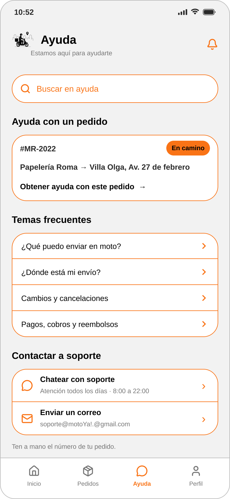
*Enlace*:
https://www.figma.com/design/Tk1cb6MQQsDdMOV6BCJTEo/Motoya-R3?node-id=383-305&t=yfqhY9mX0mEi1GvO-4

*Nombre*: Perfil del cliente
*ID*: 11
*Tamaño*: 390 x 844 
*Accion principal*: Visualizar las opciones que tienes como usuario
*Ruta HTML*: "view\clients\perfil.html"
*Imagen*:
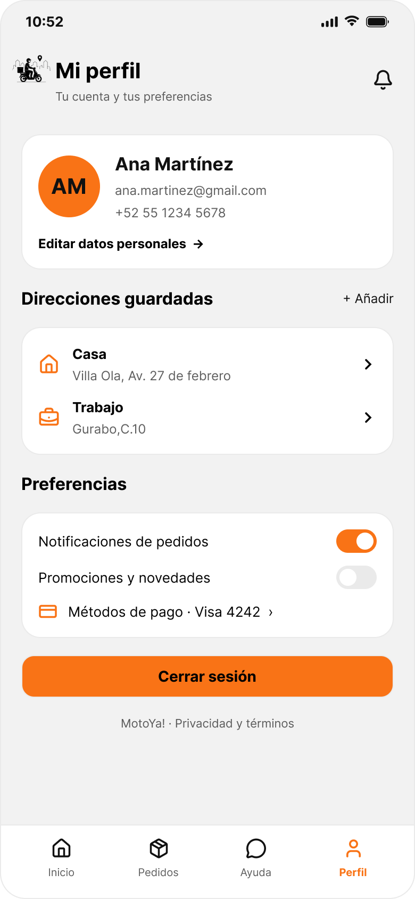
*Enlace*:
https://www.figma.com/design/Tk1cb6MQQsDdMOV6BCJTEo/Motoya-R3?node-id=362-1863&t=yfqhY9mX0mEi1GvO-4

*******************************
Mockup/admin:

*Nombre*: Resumen operativo
*ID*: 13
*Tamaño*: 1360 x 1067 
*Accion principal*: Mostrar resumen de operativos, envios, entregas...
*Ruta HTML*: "view\admin\resumen-operativo.html"
*Imagen*:
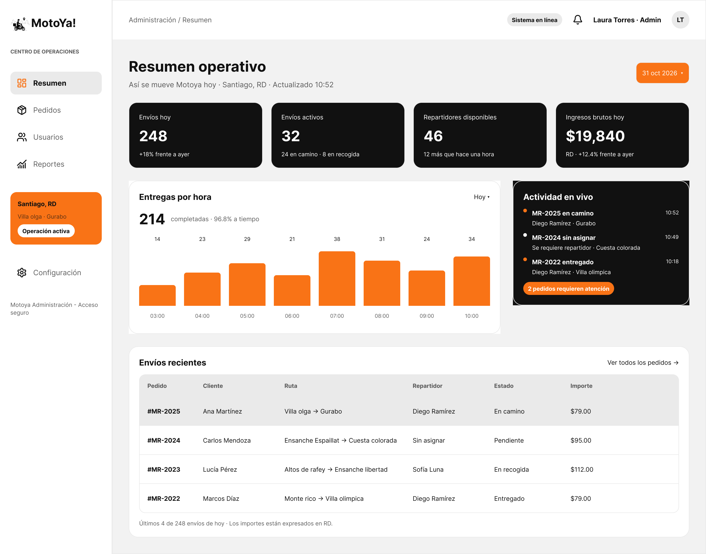
*Enlace*:
https://www.figma.com/design/Tk1cb6MQQsDdMOV6BCJTEo/Motoya-R3?node-id=362-3026&t=cezzk1HCklmrxp4w-4

*Nombre*: Gestión de pedidos
*ID*: 14
*Tamaño*: 1360 x 991 
*Accion principal*: Gestionar los pedidos
*Ruta HTML*: "view\admin\gestion-pedidos.html"
*Imagen*:
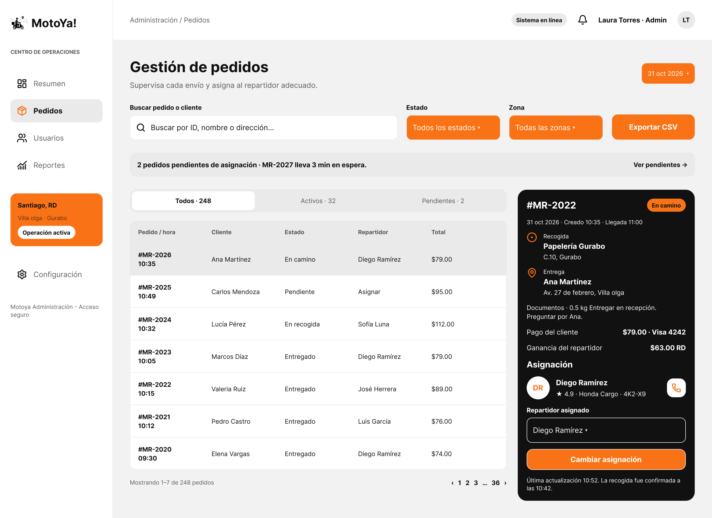
*Enlace*:
https://www.figma.com/design/Tk1cb6MQQsDdMOV6BCJTEo/Motoya-R3?node-id=362-2841&t=cezzk1HCklmrxp4w-4

*Nombre*: Usuarios y repartidores
*ID*: 15
*Tamaño*: 1360 x 1155 
*Accion principal*: gestionar usuarios, repartidores y clientes
*Ruta HTML*: "view\admin\usuarios-repartidores.html"
*Imagen*:
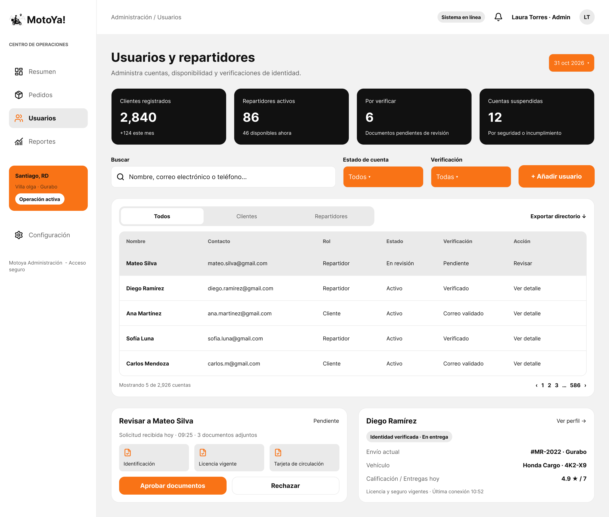
*Enlace*:
https://www.figma.com/design/Tk1cb6MQQsDdMOV6BCJTEo/Motoya-R3?node-id=362-2653&t=cezzk1HCklmrxp4w-4

*Nombre*: Reportes de ingresos y entregas
*ID*: 16
*Tamaño*: 1360 x 1291 
*Accion principal*: Observar los ingresos, entregas completadas y a tiempo
*Ruta HTML*: "view\admin\reportes.html"
*Imagen*:
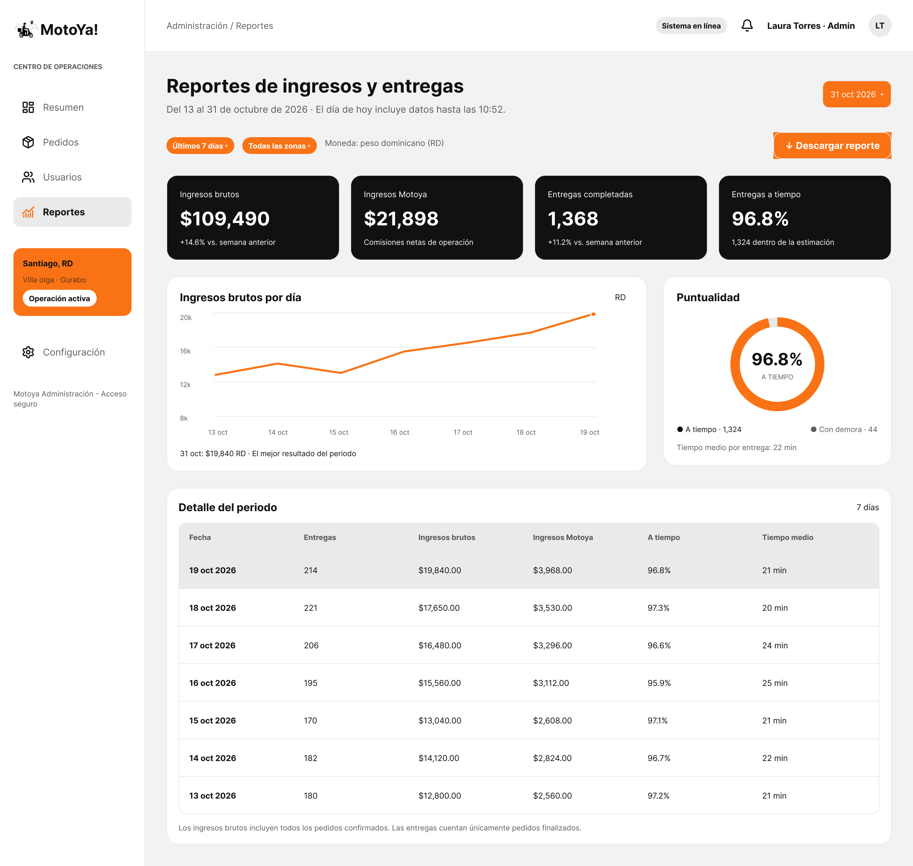
*Enlace*:
https://www.figma.com/design/Tk1cb6MQQsDdMOV6BCJTEo/Motoya-R3?node-id=362-2469&t=cezzk1HCklmrxp4w-4

*******************************
Mockup/repartidor:

*Nombre*: Inicio y disponibilidad
*ID*: 09
*Tamaño*: 376 x 856 
*Accion principal*: visualizar solicitudes que esten disponibles
*Ruta HTML*: "view\repartidor\index.html"
*Imagen*:
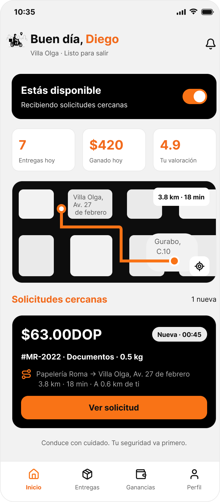
*Enlace*:
https://www.figma.com/design/Tk1cb6MQQsDdMOV6BCJTEo/Motoya-R3?node-id=362-3551&t=cezzk1HCklmrxp4w-4

*Nombre*: Detalle de una solicitud
*ID*: 10
*Tamaño*: 375 x 894 
*Accion principal*: ver detalles de la soicitud, las ubicaciones de recogida y entrega y poder aceptarlas
*Ruta HTML*: "view\repartidor\detalle-solicitud.html"
*Imagen*:
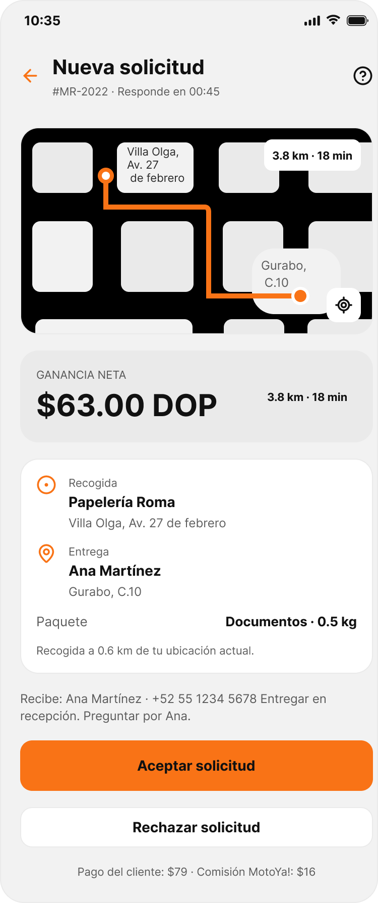
*Enlace*:
https://www.figma.com/design/Tk1cb6MQQsDdMOV6BCJTEo/Motoya-R3?node-id=362-3476&t=cezzk1HCklmrxp4w-4Z

*Nombre*: Entrega en curso
*ID*: 11
*Tamaño*: 376 x 892 
*Accion principal*: confirmar la recogida y la entrega
*Ruta HTML*: "view\repartidor\entrega.html"
*Imagen*:
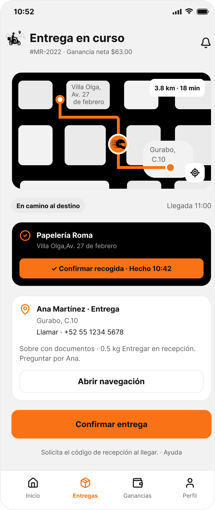
*Enlace*:
https://www.figma.com/design/Tk1cb6MQQsDdMOV6BCJTEo/Motoya-R3?node-id=362-3388&t=cezzk1HCklmrxp4w-4

*Nombre*: Ganancias e historial
*ID*: 12
*Tamaño*: 376 x 844 
*Accion principal*: Visualizar las ganancias y poder filtrarlas por el dia, semana o mes
*Ruta HTML*: "view\repartidor\ganancias.html"
*Imagen*:
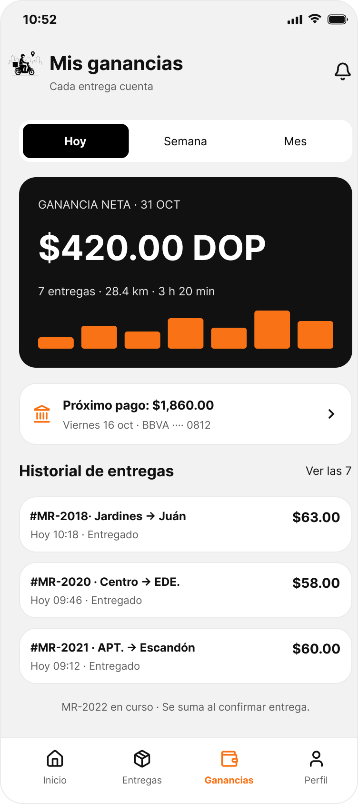
*Enlace*:
https://www.figma.com/design/Tk1cb6MQQsDdMOV6BCJTEo/Motoya-R3?node-id=362-3301&t=cezzk1HCklmrxp4w-4

*Nombre*: Mi perfil de Diego
*ID*: 13
*Tamaño*: 376 x 844 
*Accion principal*: Visualizar las opciones del perfil y editarlas
*Ruta HTML*: "view\repartidor\perfil.html"
*Imagen*:
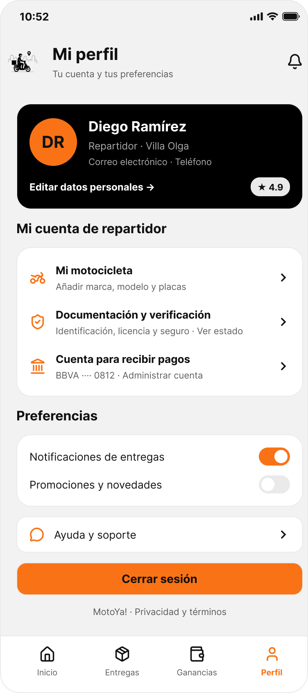
*Enlace*:
https://www.figma.com/design/Tk1cb6MQQsDdMOV6BCJTEo/Motoya-R3?node-id=362-3207&t=cezzk1HCklmrxp4w-4